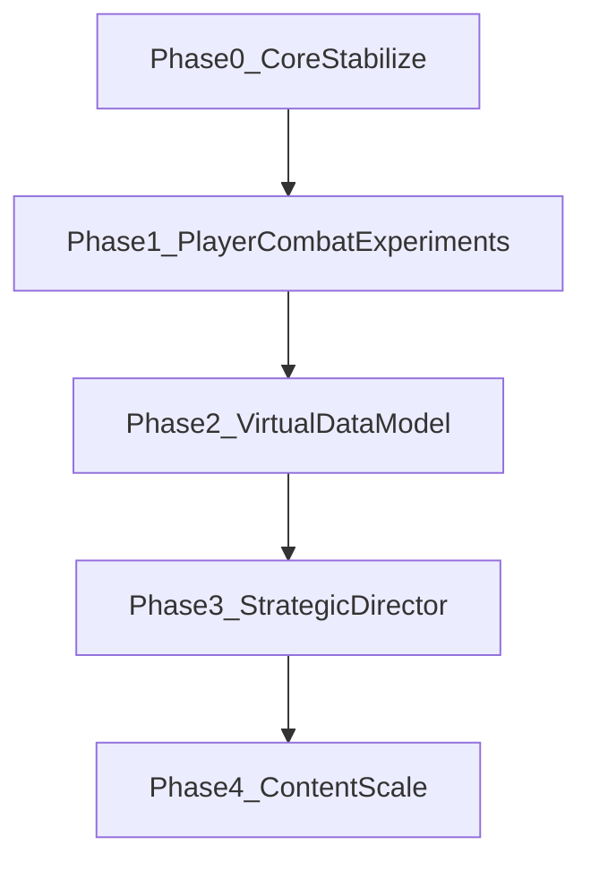

# SCR Crusader Kings — Development Roadmap

**Status:** Living document (2026-11)  
**Scope:** epScript map systems, virtual countries, and strategic AI — not TrigEdit revival.

This roadmap is the entry point for future work. Strategic detail lives in `_docs/strategy/`. Old `_docs/*Plan*.txt` files are historical inspiration only, not binding commitments.

---

## Architectural stance

**Preferred approach:** an epScript **strategic director** (Approach B) that owns countries, wars, armies, and objectives. StarCraft continues to handle pathfinding, targeting, and combat.

**Not preferred as the brain:** native `aiscript.bin` / ASC3 scripts. They are player-centric and cannot represent many independent countries or simultaneous wars. Injection research is optional and must not block this roadmap.

See [strategy/ai-architecture.md](strategy/ai-architecture.md).

---

## Current codebase (baseline)

| Module | Role today |
|--------|------------|
| `constants.eps` | Duchy IDs, state arrays, supply helpers |
| `duchies.eps` | Levies, upgrades, sieges, occupation handoff |
| `economy.eps` | Income / debt / manpower timers |
| `initialization.eps` | Nation giveaways, building refresh, test setup |
| `military.eps` | Empty shell — future army / front logic |
| `diplomacy.eps` | Empty shell — future wars / relations |
| `events.eps` | Empty shell — narrative / random events |

Progress snapshot: [epscript-progress-assessment.md](epscript-progress-assessment.md).

Useful map data: `adjecency.graphml` (province adjacency for future objective scoring).

---

## Phase 0 — Stabilize the Britain core

**Goal:** Keep the playable vertical slice solid before layering virtual-country machinery.

Priorities:

- Wire `duchyIncome[]` into economy payout (today payout reads player supply income).
- Make fortification level affect siege timer / siege-gear HP.
- Use stables level in levy composition.
- Finish partial UI (duchy name strings beyond the first few indices).
- Keep nation selection testable; defer full nation UI.

**Exit criteria:** Humans can raise levies, siege, occupy/liberate, and see coherent income/manpower on the Britain + Normandy footprint without relying on HP-decimal or TrigEdit encodings.

---

## Phase 1 — Player / combat experiments

**Goal:** Learn what StarCraft ownership, alliances, and extended players can actually do for multi-country wars.

Run the ordered tests in [strategy/priority-experiments.md](strategy/priority-experiments.md).

Decisions this phase must produce:

1. ~~How usable are P9–P11 for combat?~~ **Settled:** no vision past P8; extended slots are **order-driven combat only** (CUnit attack orders work). Prefer P1–P8 when auto-acquire matters.
2. Confirm `SetAllianceStatus` (including toward extended / P12) drives real damage — likely yes; still verify.
3. Confirm `GiveUnits` / `cgive` is safe for front reallocation.
4. Confirm same-owner virtual enemies **cannot** fight — locking in allocation requirements.

**Exit criteria:** Written experiment results (pass/fail) that constrain Phase 2 slot budget and army execution design.

---

## Phase 2 — Virtual data model

**Goal:** Stop treating StarCraft player IDs as country identity.

Introduce arrays / tables described in [strategy/virtual-countries-and-players.md](strategy/virtual-countries-and-players.md) and [strategy/unit-metadata-and-cunit.md](strategy/unit-metadata-and-cunit.md):

- `country_id` permanent identity
- province / duchy `owner_country_id` (evolve beyond SC-centric `duchyOwner`)
- wars and participants as entities
- armies with `execution_slot` + generation
- sidecar unit metadata (migrate siege `killCount` tagging)

**Exit criteria:** A levy unit and a duchy building can answer “which country?” without inferring solely from `unit.owner`. Hostile fronts that need to fight occupy different execution slots.

---

## Phase 3 — Strategic director

**Goal:** Fill `military.eps` / `diplomacy.eps` with a simple AI loop for computer-controlled countries.

Responsibilities (see [strategy/wars-diplomacy-occupation.md](strategy/wars-diplomacy-occupation.md) and AI architecture doc):

- Score objectives using adjacency + strength heuristics
- Assign armies to march / fight / occupy / defend via `Order` and existing siege rules
- Manage war join / leave at the logical layer; map alliances onto SC slots only at the execution layer
- Humans remain fully player-controlled; AI countries use the same data model

**Exit criteria:** At least one CPU country can declare or enter a war, march on an adjacent enemy duchy, complete a siege, and pick a follow-up objective without native ASC3 strategy scripts.

---

## Phase 4 — Content and systems scale

**Goal:** Expand footprint and product systems once the architecture holds.

- More duchies / nations (toward `MAX_DUCHIES` capacity)
- Human diplomacy UI (war, peace, demands) — product choices free of 2010s plan checklists
- Events module (`events.eps`)
- Optional: limited native AI as a *tactical* helper on dedicated computer slots only
- Optional research: aiscript buffer injection — never the authoritative director

---

## Non-goals

- Reviving `_Triggers` / TrigEdit libraries from git history unless explicitly requested
- Making `aiscript.bin` the primary strategic brain
- Expecting two hostile virtual countries that share one SC owner to fight via native combat
- Binding implementation to outdated `_docs/Crusader Kings plan.txt` / `CK2 Plan.txt` item lists

---

## Strategy document index

| Document | Topic |
|----------|--------|
| [strategy/ai-architecture.md](strategy/ai-architecture.md) | Approach A vs B, three layers |
| [strategy/virtual-countries-and-players.md](strategy/virtual-countries-and-players.md) | Countries, slots, allocation |
| [strategy/unit-metadata-and-cunit.md](strategy/unit-metadata-and-cunit.md) | Sidecar metadata, ownership rules |
| [strategy/wars-diplomacy-occupation.md](strategy/wars-diplomacy-occupation.md) | Wars, fronts, sieges bridge |
| [strategy/priority-experiments.md](strategy/priority-experiments.md) | Ordered technical experiments |
| [strategy/engine-delegation-and-attrition.md](strategy/engine-delegation-and-attrition.md) | Prefer engine timers; `removeTimer` supply/attrition |
| [strategy/handoff-virtual-countries-ai.md](strategy/handoff-virtual-countries-ai.md) | Archived research handoff |

---

## Reference grounding

- epScript APIs and types: `_Reference/` (especially Built-in-Functions, Built-in-Object-Types-(Extended), TrgPlayer, TrgAIScript)
- Cite `_Reference` for engine-facing claims; label community/EUD-Book-only claims as external
